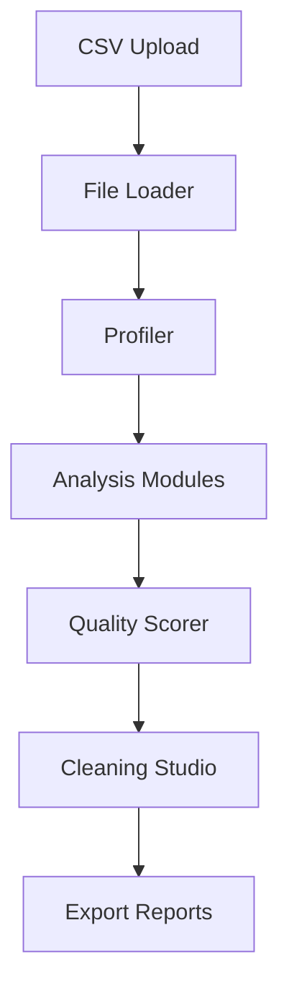

# Architecture

## Overview

CSV Data Quality Doctor follows a modular architecture with clear separation between UI, data processing, and utilities. The Streamlit frontend delegates all analysis logic to the core modules in `src/`.

## Data Flow

1. **Upload**: CSV loaded via Streamlit file uploader → validated by file_loader
2. **Profile**: Profiler generates dataset and column statistics
3. **Analysis**: Missing values, duplicates, anomalies, formats, validation modules analyze data
4. **Scoring**: Quality scorer computes overall and dimension scores
5. **Cleaning**: Cleaning engine applies operations on copies only (non-destructive)
6. **Export**: Reporter generates CSV, JSON reports

## Module Responsibilities

- `app.py`: Streamlit UI, navigation, state management
- `config.py`: Application constants and configuration
- `file_loader.py`: Robust CSV loading with encoding/delimiter handling
- `profiler.py`: Dataset profiling and statistics
- `quality_score.py`: Transparent quality scoring
- `missing_values.py`: Missing value detection and handling
- `duplicates.py`: Duplicate detection/removal
- `anomalies.py`: Outlier detection (IQR, Z-score)
- `format_checks.py`: Format consistency analysis
- `validation.py`: Data validation rules
- `cleaning.py`: Non-destructive cleaning operations
- `reporting.py`: Export utilities (CSV/JSON)
- `utils.py`: Helper functions and JSON encoding

## State Management

Streamlit session state tracks:
- Original and cleaned DataFrames
- File metadata
- Validation rules
- Analysis state

## Design Principles

- Non-destructive: Original data never modified
- Modular: Each concern in separate module
- Testable: Pure functions where possible
- Safe: Input validation, no eval/exec
- Transparent: Explainable results and scoring

